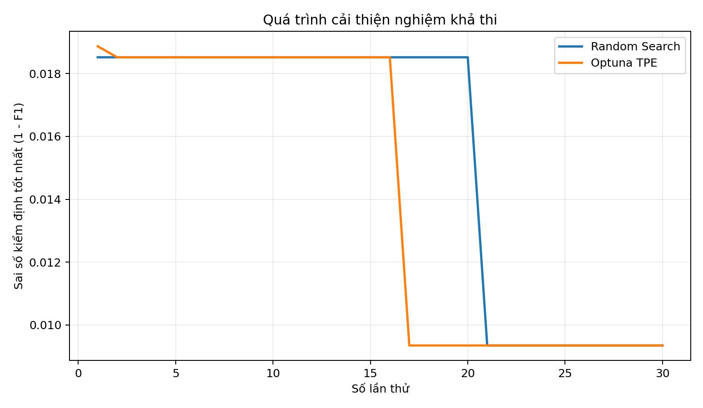
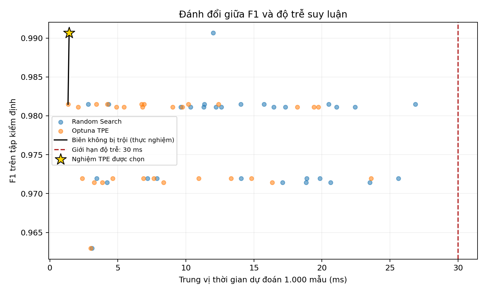

# TỐI ƯU HÓA SIÊU THAM SỐ RANDOM FOREST DƯỚI RÀNG BUỘC ĐỘ TRỄ

**Bài tập lớn cá nhân – Môn Nhập môn Tối ưu hóa – Khoa Công nghệ thông tin, Trường Đại học Văn Lang**

## 1. Giới thiệu đề tài

Đồ án nghiên cứu cách lựa chọn siêu tham số cho mô hình **Random Forest** trên bộ dữ liệu **Breast Cancer Wisconsin (Diagnostic)**. Mục đích là đạt điểm **F1 trên tập kiểm định (validation)** cao, đồng thời giữ thời gian dự đoán cho 1.000 mẫu không vượt quá **30 mili giây (ms)** trên môi trường đo thực nghiệm.

Đề tài tập trung vào **tối ưu hóa có ràng buộc**, không phải một hệ thống chẩn đoán bệnh. Kết quả chưa được kiểm chứng cho triển khai y tế thực tế.

## 2. Mô hình hóa bài toán tối ưu

- **Biến quyết định:** `x = (n_estimators, max_depth, min_samples_split, min_samples_leaf, max_features)`.
- **Hàm mục tiêu cần cực tiểu hóa:** `f(x) = 1 − F1_validation(x)`.
- **Ràng buộc:** `T_1000(x) ≤ 30 ms`, với `T_1000` là trung vị thời gian mô hình dự đoán trên cùng một tập 1.000 mẫu chuẩn đo.
- **Quy tắc chọn nghiệm:** ưu tiên cấu hình thỏa ràng buộc; trong số đó chọn F1 validation cao nhất; nếu bằng nhau thì ưu tiên độ trễ thấp hơn. Khi không có nghiệm khả thi, ưu tiên nghiệm vi phạm ít nhất.

| Siêu tham số | Miền tìm kiếm chung |
|---|---|
| `n_estimators` | Số nguyên 10–300 |
| `max_depth` | Số nguyên 2–25 |
| `min_samples_split` | Số nguyên 2–20 |
| `min_samples_leaf` | Số nguyên 1–15 |
| `max_features` | Số thực 0,2–1,0 |

## 3. Dữ liệu và thiết kế thực nghiệm

- **Nguồn dữ liệu:** Breast Cancer Wisconsin (Diagnostic), công bố trên UCI Machine Learning Repository, có sẵn qua `sklearn.datasets.load_breast_cancer()`.
- **Kích thước:** 569 mẫu, 30 đặc trưng, 2 lớp phân loại.
- **Chia dữ liệu phân tầng, seed = 42:** tập huấn luyện 397 mẫu, tập kiểm định 86 mẫu, tập kiểm thử 86 mẫu.
- **Phương pháp so sánh:** mô hình Random Forest mặc định, Random Search (30 lần thử) và Optuna TPE (30 lần thử).
- **Tính công bằng:** cùng dữ liệu, miền tham số, số lần thử và cách đo F1/độ trễ. Không dùng nhãn tập kiểm thử để chọn siêu tham số.
- **Đo độ trễ:** tập chuẩn đo cố định 1.000 hàng được lấy mẫu có hoàn lại từ validation; mỗi lần thử có chạy khởi động và lấy trung vị của 3 lượt đo. Đánh giá cuối sử dụng ít nhất 11 lượt đo.
- **Môi trường đo:** các thông số phiên bản và hệ điều hành được lưu trong `results/experiment_metadata.json`.

**Lưu ý:** Rừng ngẫu nhiên (Random Forest) không yêu cầu chuẩn hóa đặc trưng. Dự án không dùng `StandardScaler`.

## 4. Kết quả chạy thực nghiệm

Lệnh tái lập lượt chạy đã lưu:

```bash
python src/pipeline.py --trials 30 --tau_max 30 --seed 42 --repeats 3
```

| Phương pháp | F1 trên test | Độ chính xác test | Độ trễ / 1.000 mẫu (ms) | Thỏa ràng buộc |
|---|---:|---:|---:|---|
| Random Forest mặc định | 0,9434 | 0,9302 | 9,553 | Có |
| Random Search | **0,9533** | **0,9419** | 12,866 | Có |
| Optuna TPE | 0,9423 | 0,9302 | **1,207** | Có |

**Nhận xét:** trong một lượt chạy này, Random Search có F1 trên tập kiểm thử cao nhất, trong khi cấu hình tìm được bởi Optuna TPE có độ trễ thấp nhất. Tất cả **60/60 lần thử tìm kiếm** đều thỏa ràng buộc 30 ms, nên giới hạn này chưa đủ chặt trên máy đo. **Không thể kết luận TPE luôn tốt hơn Random Search từ một seed.**

### Siêu tham số được chọn dựa trên validation

| Siêu tham số | Random Search | Optuna TPE |
|---|---:|---:|
| Lần thử được chọn | 21 | 17 |
| `n_estimators` | 137 | 11 |
| `max_depth` | 18 | 14 |
| `min_samples_split` | 14 | 13 |
| `min_samples_leaf` | 8 | 7 |
| `max_features` | 0,6521888851849511 | 0,8682198938514627 |

### Hình 1. Quá trình cải thiện sai số theo số lần thử



### Hình 2. Đánh đổi giữa F1 và độ trễ suy luận



## 5. Cách chạy trên máy tính

**Yêu cầu:** Python từ phiên bản 3.10 trở lên, có kết nối mạng trong lần cài thư viện đầu tiên.

**Bước 1:** Mở thư mục dự án bằng Visual Studio Code, chọn Terminal → New Terminal.

**Bước 2:** Cài các thư viện Python:

```bash
python -m pip install -r requirements.txt
```

**Bước 3:** Chạy thực nghiệm:

```bash
python src/pipeline.py --trials 30 --tau_max 30 --seed 42 --repeats 3
```

**Bước 4:** Mở thư mục `results/` và `figures/` để xem dữ liệu và hình kết quả. Chương trình **ghi đè** các tệp kết quả hiện có khi chạy lại; thời gian đo có thể khác tùy máy.

## 6. Cấu trúc thư mục

```text
constrained-hpo-accuracy-latency/
├── README.md                     # Giới thiệu đề tài, cách chạy, kết quả
├── requirements.txt              # Danh sách thư viện cần cài
├── .gitignore                    # Tệp/thư mục không đưa lên GitHub
├── data/
│   └── README.md                 # Nguồn gốc và quy trình xử lý dữ liệu
├── src/
│   └── pipeline.py               # Chương trình tối ưu hóa
├── results/
│   ├── trials_log.csv            # Nhật ký tất cả lần thử
│   ├── test_benchmark_summary.csv # Kết quả đánh giá trên test
│   └── experiment_metadata.json  # Thông tin môi trường và cấu hình
├── figures/
│   ├── convergence_history.png   # Đường hội tụ
│   └── pareto_accuracy_latency.png # Đánh đổi F1 và độ trễ
└── report/
    ├── bao_cao_do_an_toi_uu_hoa.docx # Báo cáo Word
    └── bao_cao_do_an_toi_uu_hoa.pdf  # Báo cáo PDF
```

## 7. Hạn chế và hướng phát triển

- Hiện mới chạy một seed và một cách chia dữ liệu. Cần thử nhiều seed để báo trung bình ± độ lệch chuẩn.
- Chỉ đo độ trễ trên một môi trường máy tính. Các thông số sẽ thay đổi theo phần cứng và tải CPU.
- Ràng buộc 30 ms chưa làm phân biệt nghiệm khả thi ở phiên chạy này. Nên thử giới hạn chặt hơn sau khi xác định thiết bị triển khai.
- Dữ liệu phục vụ học thuật; kết quả **không có giá trị kết luận chẩn đoán y khoa**.
- Việc lựa chọn triển khai phải dựa trên tiêu chí ưu tiên đã xác định từ trước, không thay đổi tiêu chí theo kết quả test.

## 8. Nguồn dữ liệu và tài liệu tham khảo

- Wolberg, W. H., Street, W. N., & Mangasarian, O. L. (1995). *Breast Cancer Wisconsin (Diagnostic)*. UCI Machine Learning Repository. https://doi.org/10.24432/C5DW2B
- Breiman, L. (2001). *Random Forests*. Machine Learning, 45, 5–32.
- Akiba, T. và cộng sự (2019). *Optuna: A Next-generation Hyperparameter Optimization Framework*.

## 9. Công cụ AI hỗ trợ

AI được sử dụng để hỗ trợ rà soát chương trình, kiểm tra tính nhất quán giữa nhật ký và báo cáo, biên tập tài liệu. Người thực hiện cần tự chạy lại và giải thích được kết quả; số liệu trong báo cáo được lấy từ các file CSV/JSON trong thư mục `results/`.

## 10. Hướng dẫn nộp GitHub

1. Tạo repository tên `constrained-hpo-accuracy-latency` ở chế độ **Public (công khai)**.
2. Tải **nội dung các thư mục và tệp đã giải nén**, không chỉ đăng một tệp ZIP.
3. Kiểm tra trang chủ GitHub hiển thị file `README.md` này và mở được `src/pipeline.py`, `figures/`, `report/`.
4. Điền đường dẫn GitHub thật vào trang bìa báo cáo và nộp lên LMS.
5. Lưu commit theo quá trình làm thực tế; không tạo hoặc giả mạo lịch sử commit trước đây.
