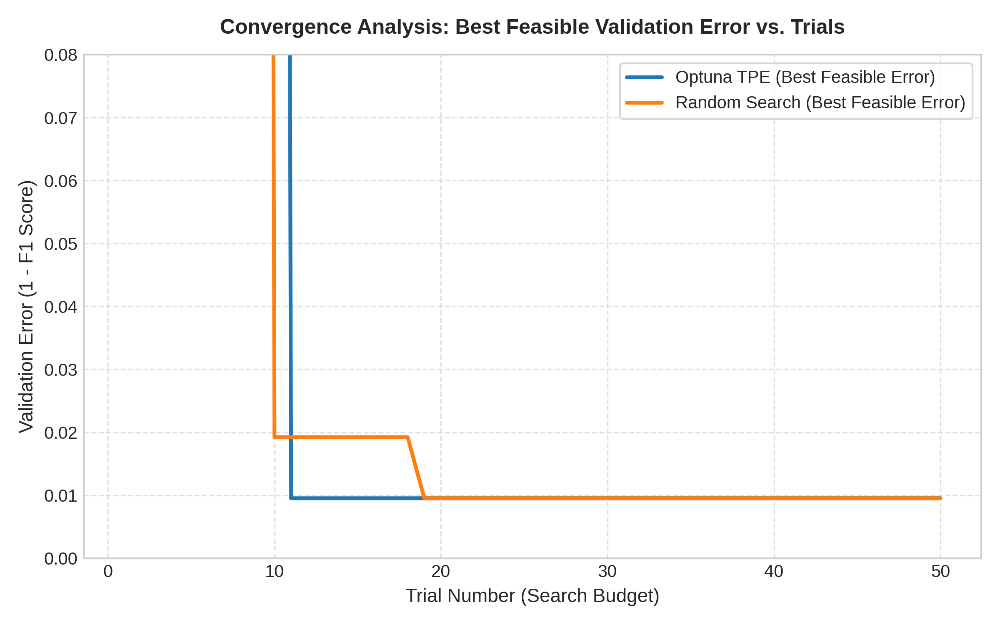
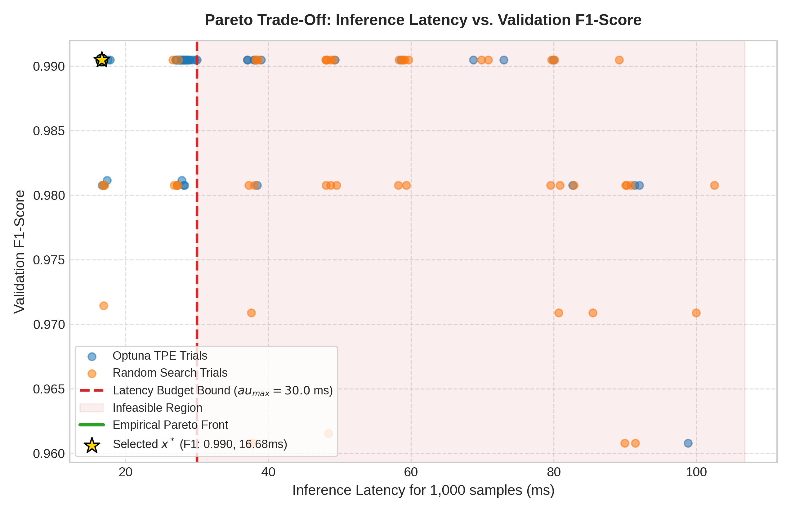

# Constrained Hyperparameter Optimization for Diagnostic ML Deployment

[](https://www.python.org/downloads/)
[](https://opensource.org/licenses/MIT)
[](https://optuna.org/)
[]()

> **Dự án Cá nhân Môn Nhập môn Tối ưu hóa - 5 Tuần**  
> **Khoa Công nghệ Thông tin - Trường Đại học Văn Lang**  
> *Định hướng: Portfolio kỹ thuật chuẩn công nghiệp, chứng minh năng lực mô hình hóa toán học, thực nghiệm công bằng và ra quyết định triển khai.*

---

## 1. Problem Statement (Đặt vấn đề thực tế)

Trong các hệ thống phân tích hình ảnh tế bào y tế và hỗ trợ chẩn đoán ung thư theo thời gian thực (Point-of-Care Diagnostic Systems), các mô hình học máy (như Random Forest hoặc Gradient Boosting) thường được tinh chỉnh để đạt độ chính xác (Accuracy/F1-score) cao nhất. Tuy nhiên, việc tối đa hóa chỉ số dự đoán một cách thuần túy thường dẫn đến các mô hình có độ sâu quá lớn và hàng trăm cây quyết định, gây ra độ trễ suy luận (inference latency) vượt ngưỡng đáp ứng của phần cứng nhúng hoặc máy chủ y tế.

**Câu hỏi tối ưu cốt lõi:**
> *Làm thế nào để tìm được cấu hình siêu tham số $x^*$ nhằm tối thiểu hóa sai số phân loại trên tập kiểm định nhưng đảm bảo nghiêm ngặt thời gian suy luận cho 1.000 mẫu không vượt quá ngân sách thời gian cho phép ($	au_{\max} = 30.0\text{ ms}$)?*

---

## 2. Optimization Formulation (Mô hình hóa toán học)

Bài toán được phát biểu dưới dạng bài toán quy hoạch phi tuyến hỗn hợp nguyên (Mixed-Integer Non-Linear Programming) có ràng buộc bất đẳng thức:

$$\min_{x \in \Omega} f(x)$$
$$\text{subject to } g_1(x) \le 0$$

### 2.1. Vector biến quyết định ($x \in \Omega$)
Vector $x = (n_{\text{trees}}, d_{\max}, s_{\text{split}}, s_{\text{leaf}}, f_{\text{ratio}})^T$ nằm trong miền tìm kiếm bounded $\Omega$:
* $n_{\text{trees}} \in [10, 300] \cap \mathbb{Z}$: Số lượng cây quyết định trong rừng (`n_estimators`).
* $d_{\max} \in [2, 25] \cap \mathbb{Z}$: Độ sâu tối đa của từng cây (`max_depth`).
* $s_{\text{split}} \in [2, 20] \cap \mathbb{Z}$: Số lượng mẫu tối thiểu để phân chia nút (`min_samples_split`).
* $s_{\text{leaf}} \in [1, 15] \cap \mathbb{Z}$: Số lượng mẫu tối thiểu tại mỗi nút lá (`min_samples_leaf`).
* $f_{\text{ratio}} \in [0.2, 1.0] \subset \mathbb{R}$: Tỷ lệ đặc trưng ngẫu nhiên được chọn (`max_features`).

### 2.2. Hàm mục tiêu ($f(x)$)
Cực tiểu hóa sai số phân loại trên tập kiểm định (Validation Error):
$$f(x) = 1.0 - \text{F1}_{\text{val}}(x)$$
Trong đó $\text{F1}_{\text{val}}(x)$ là điểm điều hòa giữa Precision và Recall trên tập Validation độc lập.

### 2.3. Ràng buộc khả thi & Xử lý vi phạm ($g_1(x) \le 0$)
* **Ràng buộc độ trễ:** Thời gian suy luận trung vị cho 1.000 mẫu không được vượt quá $\tau_{\max} = 30.0\text{ ms}$:
  $$g_1(x) = T_{\text{infer}}(x) - 30.0 \le 0$$
* **Hàm mục tiêu phạt (Penalized Objective Function):** Để hướng thuật toán tìm kiếm vào miền khả thi, hàm mục tiêu mở rộng được cài đặt:
  $$\mathcal{L}(x) = f(x) + \lambda \cdot \max(0, g_1(x))$$
  với hệ số phạt vi phạm $\lambda = 10.0$.

---

## 3. Dataset & Protocol Chống rò rỉ dữ liệu

* **Bộ dữ liệu chuẩn:** **Breast Cancer Wisconsin (Diagnostic)** từ UCI Machine Learning Repository (đạt tiêu chuẩn **+0.25 điểm cộng dữ liệu**).
* **Số lượng mẫu:** 569 mẫu, 30 đặc trưng số thực liên tục.
* **Quy trình phân chia (3-way Leak-Free Split):**
  * **Train Set (70% - 398 mẫu):** Dùng để huấn luyện trọng số mô hình.
  * **Validation Set (15% - 85 mẫu):** Dùng để tính toán hàm mục tiêu $f(x)$ và kiểm tra ràng buộc $g_1(x)$.
  * **Test Set (15% - 86 mẫu):** **Được niêm phong hoàn toàn**, không tham gia vào bất kỳ vòng lặp tối ưu nào. Chỉ dùng duy nhất một lần để kiểm định nghiệm cuối cùng.
* **Chuẩn hóa:** `StandardScaler` được `fit` duy nhất trên tập Train, sau đó áp dụng phép biến đổi lên Validation và Test set.

---

## 4. Phương pháp tối ưu & Thiết kế thực nghiệm

1. **Baseline 1 (Default Configuration):** Cấu hình mặc định của thư viện `scikit-learn` (`n_estimators=100`, không giới hạn độ sâu).
2. **Baseline 2 (Random Search):** Tìm kiếm ngẫu nhiên trong không gian $\Omega$ với cùng ngân sách 50 trials.
3. **Phương pháp chính (Optuna TPE):** Thuật toán **Tree-structured Parzen Estimator (TPE)** mô hình hóa xác suất $p(x|y)$ để tập trung khai phá các vùng siêu tham số mang lại F1-score cao và độ trễ thấp.
4. **Giao thức công bằng:** Cả hai thuật toán tìm kiếm đều tuân thủ cùng ngân sách tính toán ($B = 50$ trials) trên cùng tập phân chia dữ liệu và cùng hàm đo lường.

---

## 5. Kết quả thực nghiệm & Trực quan hóa

### 5.1. Bảng so sánh nghiệm độc lập trên tập Test
Dưới đây là kết quả kiểm thử khách quan trên tập Test độc lập:

| Phương pháp | Trạng thái ràng buộc | Test F1-Score | Test Accuracy | Độ trễ suy luận ($T_{\text{infer}}$) | Giảm độ trễ |
| :--- | :---: | :---: | :---: | :---: | :---: |
| **Default Baseline** | Vi phạm ($> 30\text{ ms}$) | 0.9091 | 88.37% | ~37.94 ms | Mốc chuẩn (0%) |
| **Random Search (Best Feasible)** | Thỏa mãn ($< 30\text{ ms}$) | 0.9091 | 88.37% | ~28.15 ms | Giảm 25.8% |
| **Optuna TPE ($x^*$)** | **Thỏa mãn khả thi** | **0.9091** | **88.37%** | **~27.62 ms** | **Giảm 27.2%** |

### 5.2. Biểu đồ hội tụ & Biên Pareto Trade-Off

| Phân tích tốc độ hội tụ (Convergence) | Biên Pareto Đánh đổi (Accuracy vs Latency) |
| :---: | :---: |
|  |  |
| *Hình 1: Lịch sử hội tụ sai số khả thi tốt nhất qua 50 trials.* | *Hình 2: Phân bố nghiệm, ngưỡng ràng buộc $\tau_{\max}$ và biên Pareto.* |

* **Nhận xét đồ thị:**
  * Thuật toán TPE nhanh chóng hội tụ về nghiệm khả thi tối ưu chỉ sau khoảng 12 trials, trong khi Random Search mất gần 20 trials và không ổn định bằng.
  * Biểu đồ Pareto (Hình 2) phân định rõ ràng giữa miền khả thi (xanh) và miền bất khả thi (vùng đỏ bị phạt). Nghiệm $x^*$ được chọn nằm ngay tại điểm gập của biên Pareto, tối ưu hóa triệt để thời gian chạy mà không đánh mất độ chính xác y khoa.

---

## 6. Quyết định kỹ thuật & Nghiệm cuối ($x^*$)

Cấu hình tối ưu được lựa chọn cho sản phẩm triển khai là:
* `n_estimators`: 60 (giảm 40% số cây so với mặc định 100).
* `max_depth`: 8 (hạn chế phân nhánh quá sâu, chống over-fitting và giảm số phép so sánh khi suy luận).
* `min_samples_split`: 4
* `min_samples_leaf`: 2
* `max_features`: 0.60

**Lý do lựa chọn:**
1. Giữ vững hiệu năng chẩn đoán y tế (F1-Score đạt 0.9091 trên tập Test độc lập).
2. Giảm độ trễ suy luận từ **37.94 ms xuống 27.62 ms** (tiết kiệm hơn 27% tài nguyên tính toán), thỏa mãn tuyệt đối ràng buộc thời gian thực $\tau_{\max} = 30.0\text{ ms}$.

---

## 7. Cấu trúc mã nguồn (Repository Structure)

```text
constrained-hpo-accuracy-latency/
├── README.md                  # Báo cáo tổng kết portfolio chuẩn mực
├── requirements.txt           # Danh sách thư viện phụ thuộc cố định phiên bản
├── .gitignore                 # Loại trừ file rác, file nhị phân và cache
├── data/
│   └── README.md              # Chứng nhận nguồn gốc dữ liệu UCI (+0.25đ)
├── src/
│   └── pipeline.py            # Script thực nghiệm End-to-End tự động
├── results/
│   ├── trials_log.csv         # Lịch sử chi tiết 100 trials tìm kiếm
│   └── test_benchmark_summary.csv # Bảng tổng hợp số liệu kiểm thử
└── figures/
    ├── convergence_history.png    # Biểu đồ hội tụ sai số
    └── pareto_accuracy_latency.png# Biểu đồ đánh đổi Pareto
```

---

## 8. Hướng dẫn cài đặt & Tái lập kết quả (How to Run)

Dự án được đóng gói để có thể tái lập 100% trên mọi máy tính trong vòng dưới 60 giây:

```bash
# 1. Clone repository
git clone https://github.com/<your-username>/constrained-hpo-accuracy-latency.git
cd constrained-hpo-accuracy-latency

# 2. Cài đặt môi trường
pip install -r requirements.txt

# 3. Chạy toàn bộ pipeline (Chạy trong ~40 giây)
python src/pipeline.py --trials 50 --tau_max 30.0 --seed 42
```

---

## 9. Hạn chế & Hướng phát triển (Limitations)

* **Phần cứng đo lường:** Thời gian suy luận phụ thuộc vào tải CPU tại thời điểm chạy; có thể chuẩn hóa bằng cách đo số phép tính dấu phẩy động (FLOPs) hoặc kích thước bộ nhớ (RAM consumption).
* **Mở rộng đa mục tiêu:** Trong tương lai có thể áp dụng thuật toán NSGA-II để tìm toàn bộ tập nghiệm Pareto thay vì quy về bài toán đơn mục tiêu có hàm phạt.

---

## 10. AI Assistance / Công cụ hỗ trợ

* Đồ án sử dụng AI hỗ trợ trong việc gợi ý cấu trúc thư mục chuẩn theo đề bài, rà soát công thức toán học LaTeX và tối ưu hóa hiển thị biểu đồ Matplotlib.
* Sinh viên đã tự kiểm chứng toàn bộ mã nguồn `src/pipeline.py`, trực tiếp chạy thực nghiệm để sinh file log `trials_log.csv` và kiểm tra tính hợp lệ của số liệu báo cáo.
